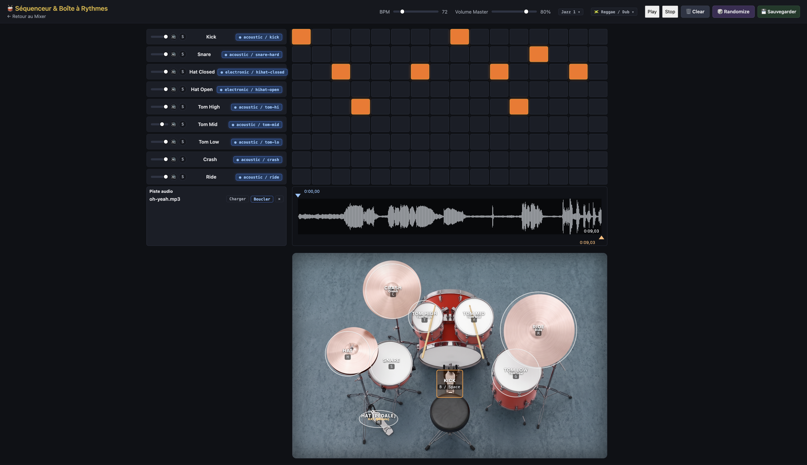

# 🥁 Séquenceur & Boîte à Rythmes — Guide d’utilisation

Cliquez sur **🥁 Séquenceur** dans l’en-tête du Mixer, ou ouvrez `http://127.0.0.1:5400/sequencer` lorsque le serveur local tourne.

## 🖼️ Aperçu de l’interface

De haut en bas : commandes de lecture et rythmes, grille de batterie, piste audio avec forme d’onde, puis batterie interactive. Sur écran large, les commandes audio se trouvent sous celles des instruments ; la forme d’onde et la batterie sont alignées sous les pas. Sur téléphone, faites défiler les pas horizontalement pour atteindre la fin de la grille : les commandes des instruments restent visibles. La forme d’onde passe sous les commandes audio, et la batterie tient dans la largeur de la page sans recadrage.

## 1. Programmer un rythme

- Cliquez sur une cellule de la grille **9 pistes × 16 pas** pour activer ou désactiver une frappe. Les pas actifs sont orange ; le curseur de lecture est bleu.
- Réglez le tempo avec **BPM** (40 à 240). **Volume Master** règle le volume général. Chaque piste de batterie dispose aussi de commandes de volume, de sourdine et de solo.
- **Play/Pause** lance ou suspend la lecture. **Stop** revient au premier pas. **Clear** efface la grille ; **Randomize** génère un nouveau rythme.
- **Rythmes** donne accès aux rythmes Musicca et **Presets** aux rythmes d’usine. Un preset peut modifier la grille, le BPM et le swing. Cliquez sur **Sauvegarder** pour nommer et enregistrer votre rythme ; retrouvez-le dans **Rythmes → Mes rythmes**.

## 2. Jouer un fichier audio avec la batterie

1. Dans **Piste audio**, sous la grille, cliquez sur **Charger** ou déposez un MP3 ou un autre fichier audio décodable par le navigateur (20 Mio maximum).
2. Par défaut, le passage sélectionné couvre tout le fichier. Faites glisser le marqueur de début au-dessus de la forme d’onde et celui de fin en dessous pour délimiter le passage. Mettez la lecture en pause ou arrêtez-la avant de déplacer les marqueurs.
3. Laissez **Boucler** activé pour répéter le passage, ou désactivez-le pour le jouer une seule fois. Les commandes **Play/Pause** et **Stop** du haut contrôlent la batterie et la piste audio. Pause conserve la position ; Stop ramène la piste audio au marqueur de début.
4. Cliquez sur **×** pour retirer le fichier. Il reste dans le navigateur jusqu’au rechargement de la page et n’est pas envoyé au serveur.

La piste audio ne remplace aucun son de batterie. Le passage joue à sa vitesse d’origine, sans calage automatique sur le BPM de la batterie.

## 3. Jouer de la batterie interactive

Cliquez sur un fût ou une cymbale pour le faire jouer directement. Vous pouvez aussi jouer au clavier :

- `B` ou `Espace` : grosse caisse
- `S` : caisse claire
- `H` : charleston
- `T` / `Y` / `G` : toms aigu, médium et grave
- `C` : crash
- `R` : ride

Cliquez sur la pédale de charleston pour basculer entre **UP** (ouvert) et **DOWN** (fermé). La pédale change l’état du charleston sans produire de frappe par elle-même.

## 4. Changer un son de batterie

Utilisez le bouton de son à droite d’une piste de batterie pour choisir un synthé Tone.js ou un échantillon WAV des kits acoustique et électronique. Pour jouer votre propre fichier en parallèle du rythme, utilisez la **Piste audio** séparée.
