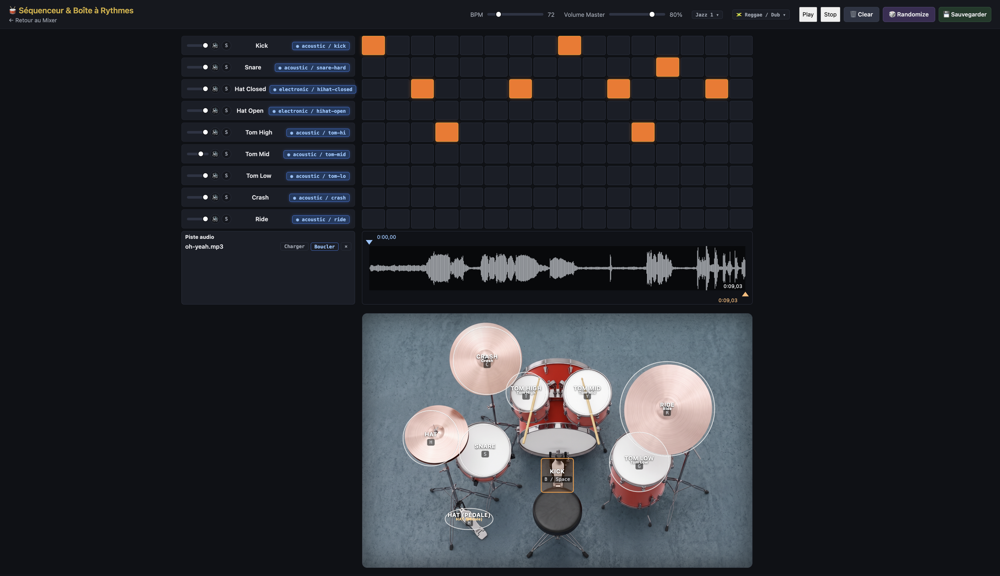

# 🥁 Sequencer & Drum Machine — User Guide

Open **🥁 Sequencer** from the Mixer header, or go to `http://127.0.0.1:5400/sequencer` while the local server is running.

## 🖼️ Interface overview

From top to bottom: transport and presets, drum grid, audio track with waveform, and interactive drum kit. On wide screens, the audio controls sit below the instrument controls, and the waveform and drum kit align with the steps. On phones, swipe the steps horizontally to reach the end of the grid; the instrument controls stay visible. The waveform stacks below the audio controls, and the kit fits the page without cropping.

## 1. Program a drum pattern

- Click any cell in the **9-track × 16-step** grid to toggle a hit. Orange marks active steps; blue marks the current playback step.
- Set the tempo with **BPM** (40–240). **Volume Master** controls the overall volume. Drum tracks also have individual volume, mute and solo controls.
- **Play/Pause** starts or pauses playback. **Stop** returns to the first step. **Clear** empties the grid; **Randomize** generates a new pattern.
- **Rythmes** loads Musicca patterns and **Presets** loads factory patterns. Presets can change the grid, BPM and swing. Click **Sauvegarder** to name and save your rhythm; find it again under **Mes rythmes** in the **Rythmes** menu.

## 2. Play a local audio file alongside the drums

1. In **Piste audio** below the grid, click **Charger** or drop an MP3 or another audio file your browser can decode (up to 20 MiB).
2. The waveform initially shows the entire file as the selected passage. Drag the start marker above the waveform and the end marker below it to trim the passage. Pause or stop playback before moving the markers.
3. Leave **Boucler** on to repeat the passage, or turn it off to play the passage once. Use **Play/Pause** and **Stop** at the top: they control both the drums and audio. Pause keeps the current position; Stop takes the audio back to the start marker.
4. Click **×** to remove the file. It stays in the browser until you reload the page and is never uploaded.

The audio track does not replace any drum sound. It plays at its original speed, without automatic matching to the drum BPM.

## 3. Play the interactive kit

Click a drum or cymbal to trigger it directly. You can also use the keyboard:

- `B` or `Space`: kick
- `S`: snare
- `H`: hi-hat
- `T` / `Y` / `G`: high, mid and low toms
- `C`: crash
- `R`: ride

Click the hi-hat pedal to switch between **UP** (open) and **DOWN** (closed). The pedal changes the hi-hat state without playing a hit itself.

## 4. Change a drum sound

Use the sound button on the right of a drum track to choose a Tone.js synth or a built-in WAV sample from the Acoustic or Electronic kit. To play your own file alongside the pattern, use the separate **Piste audio** instead.
